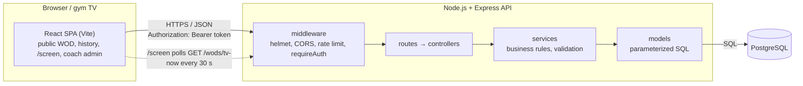
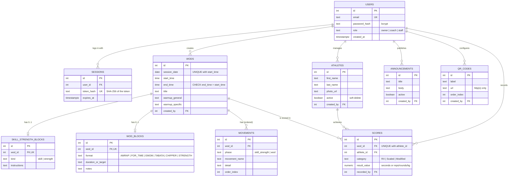

# boxtrack

Web app for CrossFit LAB (Toulouse): structured daily WOD authoring, public WOD history, protected coach administration, and a broadcast `/screen` view for the gym's TV. The cahier des charges' Optional tier (athletes, scores and leaderboards, announcements, QR codes) is implemented in the API on top of the Core V1.

## Documentation

- [Idea Development - Team, Roles, Stakeholders, Brainstorming, MVP Decision](docs/01-idea-development.md)
- [Project Charter - High-Level Plan & Timeline](docs/02-project-charter.md)
- [Technical Documentation - Architecture, Data Model, API, SCM/QA](docs/03-technical-documentation.md)
- [API contract - every endpoint, request/response and error](backend/API_CONTRACT.md)
- [Testing evidence - strategy and latest results](docs/testing/README.md)

## Architecture

Three tiers: a React single-page app (public views, coach admin, `/screen` TV view), a Node.js +
Express REST API, and a PostgreSQL database. The front-end only ever talks to the API over
HTTPS/JSON; the API is the only component with database access.



- **Layers** (`backend/src`): routes only map URLs, controllers translate HTTP ↔ service calls,
  services hold every business rule (schedules, WOD formats, ranking, validation), models are the
  only place SQL lives. Errors are one `ApiError` shape turned into JSON by a single error handler.
- **Authentication**: email + bcrypt-hashed password → a random 256-bit token, stored only as a
  SHA-256 hash in the `sessions` table, valid 7 days, revoked on logout. Every `/api/admin/*`
  route goes through `requireAuth`; public `GET` routes never need a token.
- **Time**: "today" and "now" are computed in Europe/Paris on the server, so the TV view and the
  public page never drift with the hosting provider's timezone.

## Database



The schema is [`backend/db/schema.sql`](backend/db/schema.sql) (every constraint is enforced by
PostgreSQL, not just by the API). The reasoning behind each table - why one `movements` table for
both phases, why `(session_date, start_time)` is the uniqueness key, why scores keep a single
numeric column - is in [docs/03 §2.3](docs/03-technical-documentation.md).

## Repository layout

```
backend/            Express API - see backend/README.md
  src/              routes, controllers, services, models, middleware
  db/               schema.sql, seed.sql (demo data), migrations/
  scripts/          db:setup, user:create
  tests/            unit + integration (Jest, Supertest)
src/                React front-end (see below)
docs/               project documentation, Postman collection, testing evidence
.github/workflows/  CI
```

## Back-end quick start

Full instructions (environment variables, production checklist, tests):
[backend/README.md](backend/README.md).

```bash
cd backend
npm install
cp .env.example .env            # set DATABASE_URL
npm run db:setup -- --seed      # tables + demo data (demo login in backend/README.md)
npm run dev                     # http://localhost:3000, GET /health → {"status":"ok"}
```

Tests: `npm test` (unit), `npm run test:integration` (needs a disposable database), and the
Postman collection in `docs/postman/` (run with Newman). All three run green - see
[docs/testing](docs/testing/README.md). GitHub Actions runs lint, format check, unit and
integration tests on every push touching `backend/`.

## Front-end prototype

The `panaki` branch contains the React/Vite front-end proposal for the Core V1 flow:

- public WOD of the day, session history and session detail;
- dedicated zero-navigation `/screen` TV view;
- coach login UI and complete create/edit form;
- AMRAP, For Time, EMOM, Tabata, Chipper and Strength formats;
- loading, empty and error states.

The default `demo` mode uses isolated sample sessions from `src/data/demoSessions.js`. It is visibly
labelled and must not be treated as authentication or persistent administration. To connect Kevin's
Core V1 API, copy `.env.example` to `.env`, set `VITE_DATA_MODE=api`, and configure
`VITE_API_BASE_URL`.

```bash
npm install
npm run dev
```

Quality checks:

```bash
npm run lint
npm run build
```

The dark/orange interface is a working visual proposal. It is not presented as a visual direction
approved by CrossFit LAB; sponsor review is still required before it becomes the final design.

## Team

- **Kevin Rigal** - back-end / data lead (API, database, authentication, tests, CI).
- **Panaki Gillot** - front-end / UX lead (React app, public views, `/screen`, coach interface).

Roles and their history: [docs/01 §1.2](docs/01-idea-development.md).

Sponsor: Timothé Garde, CrossFit LAB (Toulouse). Holberton School - DWWM, RNCP 37674.
